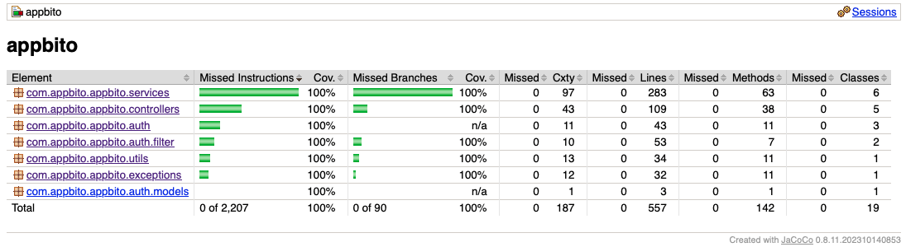
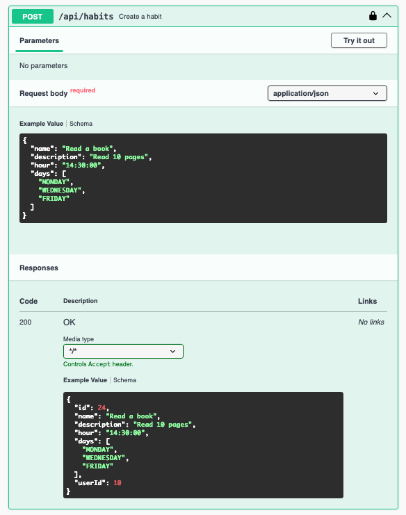

# Appbito Backend API - Version 2


The core backend service for the Appbito platform. This API handles user authentication, profile management, habit tracking, and progress reporting. Version 2 introduces a completely refactored security architecture, profile-based access control, comprehensive E2E testing workflows, and strict code quality enforcement.

## 🏗️ Architecture & Tech Stack

*   **Framework:** Java Spring Boot 3
*   **Database:** MySQL 8
*   **Security:** Spring Security with custom JWT implementation
*   **Build Tool:** Maven
*   **Infrastructure:** Docker & Docker Compose (ARM64 optimized)

### 🔐 Security Highlights
*   **Stateless Authentication:** JWT-based authentication using modern signing algorithms (HS512).
*   **Environment-Based Rules:** Dynamic `SecurityFilterChain` that rigidly isolates Development/Testing endpoints from the Production environment using Spring `@Profile`.
*   **Secure Token Handling:** Strict token validation filters mapped to custom HTTP exception responses (401/403).

---

## 🔎 Code Quality & Static Analysis

This project adheres to the highest industry standards for code reliability and maintainability. The build pipeline strictly enforces zero violations across multiple static analysis tools:

*   **JaCoCo:** 100% Code Coverage on security configurations and controllers.
*   **SpotBugs:** Bytecode analysis to prevent performance and logic bugs.
*   **Checkstyle:** Strict adherence to Java coding standards.
*   **PMD & CPD:** Source code analysis and Copy-Paste Detection to ensure clean, non-redundant logic.



---

## 📂 Repository Structure

```text
appbito-backend/
├── docs/                     # Documentation and testing assets
│   ├── postman/              # E2E test collections JSON
│   └── assets/               # Architecture diagrams and coverage reports
├── src/
│   ├── main/                 # Application source code
│   └── test/                 # Unit and Integration tests
├── docker-compose.yml        # Multi-container orchestration
├── Dockerfile                # Multi-stage image build
├── .env.example              # Environment variables template
└── README.md
```

---

## 🚀 Getting Started

### Prerequisites
*   Java 17 or higher
*   Maven 3.8+
*   Docker & Docker Compose (For containerized execution)

### Environment Setup
This project uses a `.env` file for configuration. Before starting the application, you must create your local environment file:

1. Copy the example file:
   ```bash
   cp .env.example .env
   ```
2. Open `.env` and fill in your local Database credentials, Email configuration, and `JWT_SECRET`.

### Installation & Execution

**Option A: Running with Docker (Recommended)**
```bash
git clone https://github.com/JozRamirez10/Appbito-Backend.git
cd Appbito-Backend

# 1. Create your local environment file
cp .env.example .env

# STOP 🛑: Open the .env file in your editor and fill in your Database, Email, and JWT credentials before continuing!

# 2. Build and run the containers
docker-compose up -d --build
```

**Option B: Running locally with Maven**
```bash
git clone https://github.com/JozRamirez10/Appbito-Backend.git
cd Appbito-Backend

# 1. Create your local environment file
cp .env.example .env

# STOP 🛑: Open the .env file in your editor and fill in your Database, Email, and JWT credentials before continuing!

# 2. Compile and run the application
mvn clean install
mvn spring-boot:run -Dspring-boot.run.profiles=dev
```

---

## 📚 API Documentation & E2E Testing

This project provides comprehensive documentation and testing suites, covering both local development exploration and full lifecycle End-to-End testing.

### Local API Explorer (Swagger UI)
For active development, the API is self-documented using **OpenAPI (Swagger)**. When running the application locally under the `dev` profile, you can explore endpoints, view schemas, and execute test requests interactively.
*   **Access UI:** `http://localhost:8080/swagger-ui.html`
*   *(Note: For security reasons, Swagger is strictly disabled in the `prod` profile).*



**How to run the E2E tests:**
1. Open Postman.
2. Click **Import** and select the `docs/postman/Appbito.postman_collection.json` file.
3. Import the local `.env` variables into your Postman environment.
4. Run the collection.

### API Workflows (Postman Flows)
Complex business logic and stateful testing sequences (such as the complete lifecycle from User Registration to Login, Habit Creation, and Progress Tracking) are visually mapped using Postman Flows.

🔗 **[Explore the Interactive API Flow here](https://jozfamas-team.postman.co/workspace/My-Workspace~87420bfe-9f59-4fc9-89b1-f6f6210014bf/flow/6a5920127ee77d01666d3a35)**

---

## 📄 License

This project is licensed under the MIT License. See the [LICENSE](LICENSE) file for details.

---

## 🤝 Contributing
1. Create your Feature Branch (`git checkout -b feature/AmazingFeature`)
2. Commit your Changes (`git commit -m 'Add some AmazingFeature'`)
3. Push to the Branch (`git push origin feature/AmazingFeature`)
4. Open a Pull Request ensuring all JaCoCo, SpotBugs, and Checkstyle tests pass.
